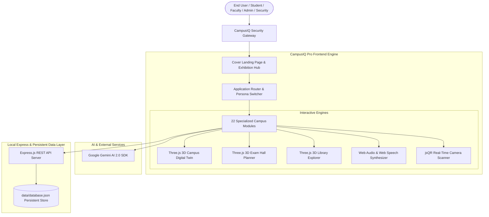

# 🎓 CampusIQ Pro — Next-Gen AI-Powered Smart Campus Operating System & 3D Digital Twin

<div align="center">

[](https://react.dev/)
[](https://www.typescriptlang.org/)
[](https://vitejs.dev/)
[](https://threejs.org/)
[](https://tailwindcss.com/)
[](https://ai.google.dev/)
[](LICENSE)

<br/>

**A comprehensive, interactive Institutional Management Platform featuring real-time 3D Digital Twin simulations, contactless smartcard attendance with automated voice announcements, AI academic advisory, and zero-trust role-based governance.**

[Live Application Documentation](PROJECT_DOCUMENTATION.md) · [Quick Start](#-quick-start) · [Core Modules](#-core-modules) · [Architecture](#-system-architecture) · [Demo Personas](#-demo-personas--role-clearance)

</div>

---

## 📌 Executive Overview

**CampusIQ Pro** is an enterprise-grade digital campus operating system designed for modern universities and research institutions. Bridging the gap between legacy administrative ERPs and immersive modern web technologies, CampusIQ Pro unifies student identity, facility scheduling, turnstile security, automated examination seating, and career advancement into a single, cohesive glassmorphic interface.

### ✨ What Makes CampusIQ Pro Unique?
1. **🌐 Real-Time 3D Campus Digital Twin**: Built with Three.js WebGL, offering interactive orbital exploration of campus zones, real-time node telemetry, and spatial facility tracking.
2. **🔊 Contactless Attendance with Instant Speech Announcements**: Dual-tone ISO 14443A NFC audio chimes combined with the Web Speech API that speaks student names and roll numbers aloud upon badge scanning or tap simulation.
3. **📐 3D Examination Hall Seating & Anti-Cheat Planner**: Interactive 3D auditorium grid providing randomized department segregation, dynamic bench allocation, and printable hall tickets.
4. **📚 3D Virtual Central Library Explorer**: Walk through virtual library book aisles, locate books spatially on shelves, and track circulation loans in real time.
5. **🤖 Gemini AI Academic & Career Advisor**: Direct integration with Google Gemini AI for customized academic trajectory analysis, semester planning, and skill gap forecasting.
6. **🛡️ Unified Institutional Security & RBAC Gateway**: Seamless single sign-on experience with pre-configured institutional clearance tiers (Student, Faculty, Dean, Security Staff) and animated verification transitions.

---

## 🏛️ System Architecture



---

## 🚀 Key Modules & Capabilities

| Module | Description | Core Technology |
| :--- | :--- | :--- |
| **3D Campus Digital Twin** | Orbital 3D campus visualization with interactive nodes, live occupancy telemetry, and lighting control | Three.js, WebGL, Lucide |
| **Attendance & Voice Turnstile** | Contactless tap & QR camera scanning with automated speech synthesis announcing student name and roll number | Web Speech API, Web Audio API, jsQR |
| **3D Exam Hall Planner** | Interactive 3D hall seating allocation, anti-cheat randomized placement, and PDF hall ticket generation | Three.js, React 19, Motion |
| **3D Virtual Library** | Interactive shelf locator, aisle navigation, real-time catalog search, and book circulation tracking | Three.js, Canvas Raycasting |
| **AI Academic Advisor** | Real-time course advising, career trajectory matching, and graduation roadmap generation | Google Gemini 2.4 API |
| **Digital Smart ID Cards** | Holographic student ID cards with dynamic cryptographic QR codes and NFC tap simulation | CSS 3D Transforms, QRCode |
| **Smart Gate Pass System** | Automated day/night movement pass requests with parental approval workflows and QR gate verification | Express REST, JSON Storage |
| **Queue-less Smart Canteen** | Menu browsing, nutritional breakdown, contactless ordering, and real-time live token queue | Tailwind CSS, State Engine |
| **Skill Passport** | Verifiable student micro-credentials, extracurricular certifications, and cryptographic validation hashes | SHA-256 Mock Hashes, React |
| **Campus Analytics** | Institutional metrics, gate traffic heatmaps, facility utilization KPIs, and attendance trends | Charting Engine, Tailwind Grid |

---

## 💻 Tech Stack

- **Frontend Core**: React 19, TypeScript 5, Vite 8 (Hot Module Replacement with customized Windows path debouncing)
- **3D Graphics & Visualization**: Three.js (r186), HTML5 WebGL Canvas, Orbital Controls, Mesh Raycasting
- **Styling & Motion**: Tailwind CSS v4, Motion (Framer Motion v12), Lucide React Icons
- **Voice & Auditory Feedback**: Native Web Audio API (Synthesizer Chimes), Native Web Speech API (`SpeechSynthesisUtterance`)
- **Artificial Intelligence**: `@google/genai` (Google Gemini 2.0 / 2.5 Flash API)
- **Computer Vision & Codes**: `jsQR` (In-browser real-time camera QR decoding), `qrcode` (SVG/Canvas QR Generation)
- **Backend & Storage**: Node.js, Express 4, `tsx` TypeScript execution, atomic JSON local database persistence

---

## ⚡ Quick Start

### Prerequisites
- [Node.js](https://nodejs.org/) (v18.x or newer recommended)
- `npm` or `bun` package manager

### 1. Clone the Repository
```bash
git clone https://github.com/purammohanasrija-arch/CampusIQ-Pro.git
cd CampusIQ-Pro
```

### 2. Install Dependencies
```bash
npm install
```

### 3. Environment Configuration
Create a `.env.local` file in the root directory (or copy from `.env.example`):
```env
GEMINI_API_KEY=your_google_gemini_api_key_here
PORT=3000
```
> *Note: If a Gemini API key is not provided, the AI Advisor will automatically operate in offline mock demonstration mode.*

### 4. Run the Development Server
```bash
npm run dev
```

The application will start on:
- **Local Access**: `http://localhost:3000`
- **Network Access**: `http://<your-lan-ip>:3000`

---

## 🔑 Demo Personas & Role Clearance

CampusIQ Pro includes four pre-configured institutional clearance accounts for instant demonstration:

| Role | Name | Email / Roll | Master Passcode | Default View |
| :--- | :--- | :--- | :--- | :--- |
| **Security Staff** | Jackson Reed | `security@campusiq.edu` | `campusiq2026` | Live Attendance Turnstile |
| **College Administrator** | Prof. Arthur Davies | `dean@campusiq.edu` | `campusiq2026` | Institutional Analytics |
| **CS Faculty** | Dr. Elena Chen | `elena.chen@campusiq.edu` | `campusiq2026` | 3D Exam Hall Planner |
| **Student** | Aarav Sharma | `241FA04001` | `campusiq2026` | Student ID & Skill Passport |

> **Pro Tip**: You can also switch roles at any point without logging out using the **Role Switcher** in the top navigation bar.

---

## 📂 Directory Structure

```
campusiq-pro/
├── data/
│   └── database.json          # Atomic JSON mock database store
├── src/
│   ├── assets/                # Event flyers, student portraits, campus renders
│   ├── components/
│   │   ├── Navbar.tsx         # Responsive top navigation with quick-role switcher
│   │   ├── Sidebar.tsx        # Collapsible drawer for all 22 campus views
│   │   ├── ThreeCampusDigitalTwin.tsx  # Interactive 3D WebGL Campus Twin
│   │   ├── QRScannerModal.tsx # Camera-driven real-time QR decoder
│   │   ├── VerificationVerdictModal.tsx # Pass/Reject gate decision modal
│   │   └── GlobalSearchModal.tsx       # Institutional command palette (Ctrl+K)
│   ├── services/
│   │   └── api.ts             # Centralized REST API client
│   ├── types/
│   │   └── campus.ts          # Strongly typed domain interfaces
│   ├── utils/
│   │   └── audioFeedback.ts   # Web Speech API & Web Audio dual-tone synthesizer
│   ├── views/
│   │   ├── CoverPageView.tsx  # Exhibition Hero & Feature Showcase
│   │   ├── LoginPageView.tsx  # Unified Security Sign-In Gateway
│   │   ├── AttendanceView.tsx # Voice Turnstile & Smartcard Tap Feed
│   │   ├── ThreeExamHallPlanner.tsx   # 3D Exam Seating Matrix
│   │   ├── ThreeLibraryExplorer.tsx   # 3D Virtual Library Aisles
│   │   ├── AIAdvisorView.tsx  # Gemini AI Career & Academic Advisor
│   │   ├── StudentsIdCardView.tsx     # Holographic Digital ID Generator
│   │   ├── GatePassView.tsx   # Automated Day/Night Pass Generator
│   │   ├── CanteenView.tsx    # Queue-less Ordering & Live Token Feed
│   │   └── ... (22 total views)
│   ├── App.tsx                # Main controller, state hydration, and routing
│   └── main.tsx               # DOM bootstrap and error boundary
├── server.ts                  # Express REST backend with live disk sync
├── PROJECT_DOCUMENTATION.md   # Exhaustive academic report (22 chapters)
└── package.json               # Dependencies and build scripts
```

---

## 📖 Complete Academic Documentation

For a comprehensive academic breakdown—including **Problem Statement, Mathematical Formulation, System Architecture Diagrams, Hardware/Software Specifications, Module Descriptions, ER Diagram, Code Explanation, and Test Cases**—please refer to the complete capstone document:

👉 **[Read the Full Project Documentation (PROJECT_DOCUMENTATION.md)](PROJECT_DOCUMENTATION.md)**

---

## 👩‍💻 Author & Attribution

- **Developer**: Puram Mohana Srija (`purammohanasrija-arch`)
- **Institution**: CampusIQ Pro Academic Initiative
- **Contact**: `purammohanasrija@gmail.com`
- **GitHub**: [@purammohanasrija-arch](https://github.com/purammohanasrija-arch)

---

## 📄 License

This project is open-source and distributed under the **MIT License**. Feel free to use, modify, and build upon this platform for academic and institutional research.
